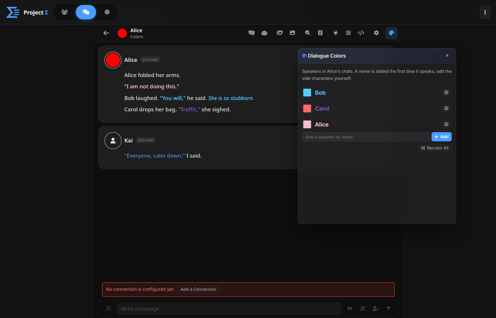
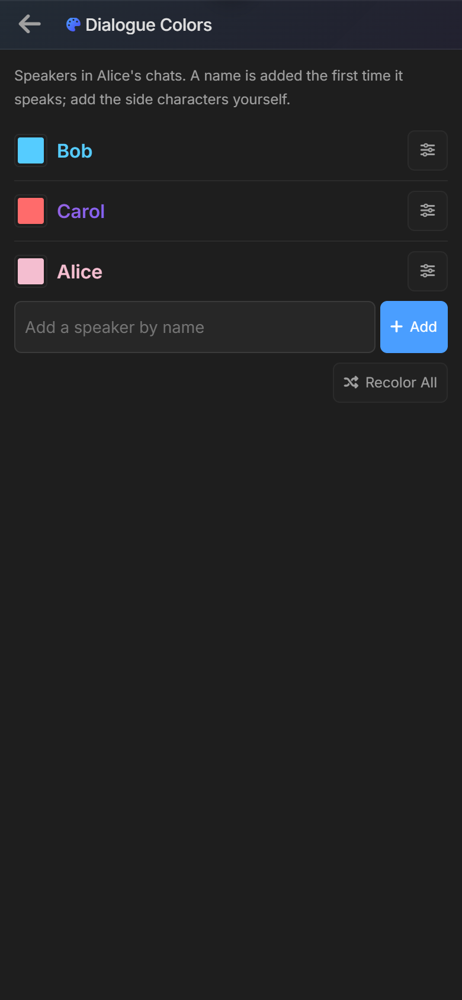

# Dialogue Colors for Project Σ

Gives each speaker's quotes and *thoughts* a colour or a gradient of their own, so a scene with
several characters reads at a glance. It works out who said each line on your device, from the
text the chat already shows. A port of the **Local DOM engine** of
[Dialogue Colors for SillyTavern](https://github.com/platberlitz/sillytavern-character-colors)
by platberlitz. Its speaker heuristics come along unchanged.

<table>
<tr><th>Desktop</th><th>Phone</th></tr>
<tr>
<td></td>
<td></td>
</tr>
</table>

## What it does

- **Colours dialogue as the chat draws it.** Each `"quote"` and `*thought*` gets the colour of
  whoever the heuristics say is speaking: speech tags ("Bob said"), action beats on the same line
  or the line above, pronouns bound to the last name, who was just spoken to, and turn-taking. A
  line nobody can be matched to takes the message's own speaker.
- **Keeps a speaker list per character card.** A name is added with a palette colour the first
  time it speaks. Add side characters yourself in the **Dialogue Colors** window (the palette
  button in the conversation). There you can also change a colour, pick one of 37 gradients or
  a random one, animate a gradient, make a speaker bold, and give nicknames ("Also called"),
  which count as the same speaker.
- **Lets you correct a line.** Open a message's menu and pick **Who Says What** to reassign any
  quote. A reassignment lasts while the message's text stays the same: a swipe or an edit
  returns that message to the guess.
- **Your own messages** are coloured once your persona's name is in the card's list. Add it by
  hand, or switch on **Add my persona automatically** in Settings > Extensions.

Settings > Extensions > Dialogue Colors: on/off, the palette for new speakers (17 palettes,
including three for colour-blind readers), which marks count as thoughts (`*` by default; empty
colours quotes only), and whether gradients move.

### Not in this version

The original's LLM engine (asking the model to write `` tags), LLM speaker verification,
style packs, storage scopes (chat/card/global), the floating legend, fonts, import/export and the
undo history are left out. See [Next steps](#next-steps).

## What it reads, writes and sends

- **Reads** the text of the messages the chat shows, and the open card's and active persona's
  names (to know who `{{char}}` and `{{user}}` are).
- **Writes** one document of its own in your account (`ext-dialogue-colors`): the speaker list
  for each card and your reassigned lines (at most 100 chats, the oldest dropped first). Your
  messages and cards are never changed.
- **Sends** nothing anywhere. It makes no model call and no network request.

## Coexisting with presets that colour text

A preset or card that writes its own `` or styled spans keeps its colours: Σ's chat
lets an author's colour win over the chat's own (`chats.css`, "A voice yields to the colour
around it"). Dialogue Colors only colours quotes and thoughts the chat drew itself. If you
use a preset's colouring instructions, turn them off, or the two will disagree about who gets
which colour.

## Next steps

- [ ] Colour a reply while it streams. Σ only runs `message.render` once a reply is stored, so a
      reply shows plain while it types and takes its colours when it lands. Waiting on a feature
      request.
- [ ] A custom gradient editor (stops, angle, type); today it is presets and random.
- [ ] Optional: the legend, per-chat lists, import/export, LLM speaker verification.

## Licence

AGPL-3.0 (see [LICENSE](LICENSE)). The code under `client/vendor/dialogue-colors/` and the parts
named in [THIRD_PARTY_NOTICES.md](THIRD_PARTY_NOTICES.md) come from Dialogue Colors for
SillyTavern under the MIT licence ([LICENSES/MIT.txt](LICENSES/MIT.txt)).
